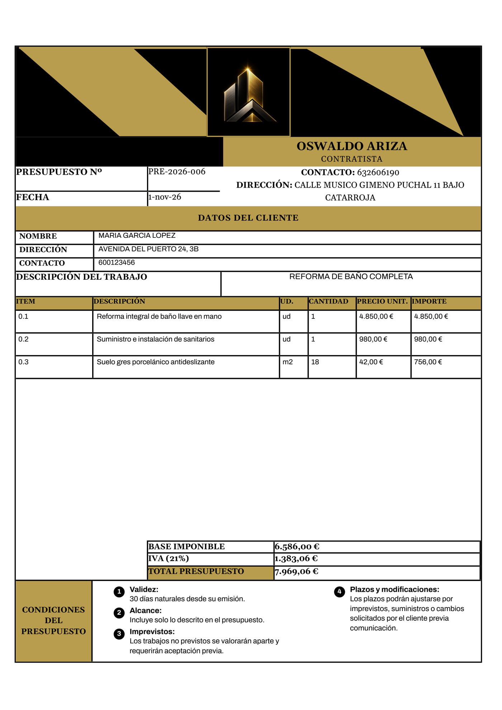

# Gestión de Presupuestos

Aplicación web para la gestión de **presupuestos y facturas** de una empresa de
contratista. Permite crear, editar y consultar documentos con un histórico
completo, generar un **PDF corporativo fiel a la plantilla de la empresa** y
enviarlo al cliente directamente por WhatsApp.

Todo está protegido por un **login con JWT** y pensado para usarse tanto desde
el escritorio como desde el móvil en obra.

<p align="center">
  
</p>

---

## Índice

1. [Qué es y para qué sirve](#1-qué-es-y-para-qué-sirve)
2. [Objetivos cumplidos](#2-objetivos-cumplidos)
3. [Arquitectura](#3-arquitectura)
4. [Tecnologías](#4-tecnologías)
5. [Puesta en marcha local](#5-puesta-en-marcha-local)
6. [Configuración](#6-configuración)
7. [API REST](#7-api-rest)
8. [Despliegue en producción](#8-despliegue-en-producción)
9. [Copias de seguridad](#9-copias-de-seguridad)
10. [Tests](#10-tests)
11. [Estructura del proyecto](#11-estructura-del-proyecto)
12. [Notas de entrega](#12-notas-de-entrega)

---

## 1. Qué es y para qué sustituye

Hasta ahora los presupuestos se preparaban a mano sobre una plantilla de
ofimática, con el riesgo habitual de errores de cálculo, numeración duplicada y
documentos que se perdían entre carpetas.

Esta aplicación elimina ese trabajo manual:

- **Numeración automática e irrepetible** por tipo y año (`PRE-2026-001`,
  `FAC-2026-002`, ...), asignada por el servidor.
- **Cálculo automático** de subtotales, IVA y totales, con comprobación de que
  las formas de pago suman el 100 %.
- **Clientes deduplicados** por NIF: al editar un cliente se actualizan sus
  datos en todos sus documentos.
- **Histórico consultable** con búsqueda y edición de cualquier documento.
- **PDF idéntico a la plantilla corporativa** de la empresa, generado en el
  navegador y listo para enviar.
- **Envío por WhatsApp** con un clic.

---

## 2. Objetivos cumplidos

| Objetivo | Estado |
| -------- | ------ |
| Acceso protegido con login (JWT) y rate limiting de intentos | ✅ |
| CRUD completo de documentos (presupuestos y facturas) | ✅ |
| Numeración automática única por tipo y año | ✅ |
| Gestión de clientes con deduplicación por NIF | ✅ |
| PDF corporativo **replanteado sobre la plantilla del cliente** | ✅ |
| Formas de pago opcionales (adelanto, reparto a medida, vencimientos) | ✅ |
| Descripción del trabajo y condiciones del presupuesto | ✅ |
| Envío por WhatsApp | ✅ |
| Diseño **responsive mobile-first** | ✅ |
| PWA instalable (manifest + iconos) | ✅ |
| Tests automatizados (backend y frontend) | ✅ |
| Despliegue en producción (Render + Vercel) | ✅ |

### El PDF

El documento se genera **en el navegador** con `@react-pdf/renderer`, siguiendo
la plantilla original de la empresa:

- Cabecera con el logo y los datos corporativos (oro sobre carbón).
- Tabla de partidas con cabecera oscura, unidades, cantidades e importes.
- Caja de totales con base imponible, IVA y total.
- Sección de **condiciones** repartida en varias columnas cuando es larga.
- **Formas de pago** opcionales con porcentajes y vencimientos.
- Marca de agua con el logo y numeración de página en el pie.
- Ocupa **una sola página** cuando cabe; pasa a dos solo si el contenido lo
  exige.

> El PDF se genera en el cliente, no en el servidor. El backend solo guarda los
> datos, por lo que el despliegue es ligero y sin dependencias de sistema.

---

## 3. Arquitectura

```mermaid
flowchart LR
    A["Navegador<br/>(escritorio o móvil)"] -->|HTTPS| B["Vercel<br/>Next.js 16"]
    B -->|API REST (JSON + JWT)| C["Render<br/>Flask + gunicorn"]
    C -->|SQLAlchemy| D[("PostgreSQL<br/>en Render")]
    B -.->|genera el PDF| A
```

- **Frontend en Vercel**: aplicación Next.js (App Router) servida por CDN con
  HTTPS y despliegues automáticos al hacer *push* a `main`.
- **Backend en Render**: API Flask detrás de **gunicorn**, con arranque
  automático de migraciones y *health check* público en `/api/salud`.
- **Base de datos en Render**: **PostgreSQL gestionado**, con copias de
  seguridad automáticas. Los datos sobreviven a deploys y reinicios.

> Los ficheros `Dockerfile` y `docker-compose.yml` del repositorio son
> **exclusivamente de desarrollo** (con recarga automática). En producción
> Render y Vercel construyen las imágenes por su cuenta.

---

## 4. Tecnologías

### Backend — `backend/`

| Tecnología | Uso |
| ---------- | --- |
| **Flask 3** | Framework web y API REST |
| **SQLAlchemy** + Flask-SQLAlchemy | ORM y modelos |
| **Flask-Migrate** (Alembic) | Migraciones de esquema |
| **PostgreSQL** + psycopg 3 | Base de datos en producción |
| **SQLite** | Base de datos local de desarrollo |
| **PyJWT** | Firma y verificación de tokens |
| **Flask-CORS** | Orígenes permitidos del frontend |
| **gunicorn** | Servidor WSGI en producción |
| **pytest** | Tests (74 pruebas) |

### Frontend — `frontend/`

| Tecnología | Uso |
| ---------- | --- |
| **Next.js 16** (App Router, Turbopack) | Aplicación y compilación |
| **React 19** | Interfaz de usuario |
| **Tailwind CSS 4** | Estilos y diseño responsive |
| **@react-pdf/renderer** | Generación del PDF en el navegador |
| **lucide-react** | Iconografía |
| **Vitest** + Testing Library | Tests (50 pruebas) |
| **ESLint** | Análisis estático |

---

## 5. Puesta en marcha local

### Requisitos

- Python 3.10 o superior
- Node.js 20 o superior
- (Opcional) Docker

### Arranque rápido

```bash
# Terminal 1 — backend (puerto 5000)
cd backend
pip install -r requirements.txt
cp .env.example .env      # y rellena SECRET_KEY / ADMIN_PASSWORD_HASH (ver abajo)
python app.py

# Terminal 2 — frontend (puerto 3000)
cd frontend
npm install
cp .env.example .env.local
npm run dev
```

Abre <http://localhost:3000> e inicia sesión con el usuario y la contraseña
configurados en `backend/.env`.

> **Aviso de puertos:** si el 3000 está ocupado, `next dev` arranca en el
> **3001** y el login fallará con *"No se pudo conectar con el servidor de
> Python"* porque ese origen no está en `CORS_ORIGINS`. Solución: libera el
> 3000 o añade `http://localhost:3001` a `CORS_ORIGINS` en `backend/.env`.

### Con Docker (solo desarrollo)

```bash
docker compose up
```

Frontend en <http://localhost:3000> y backend en <http://localhost:5000>, con
recarga automática en ambos y la base de datos en `backend/instance/`.

---

## 6. Configuración

### Backend — `backend/.env`

| Variable | Por defecto | Descripción |
| -------- | ----------- | ----------- |
| `DATABASE_URI` | `sqlite:///database.sqlite` | Cualquier URI de SQLAlchemy. En producción usa PostgreSQL |
| `DATABASE_URL` | — | Alternativa inyectada automáticamente por Render |
| `DEBUG` | `false` | `true` activa el debugger de Flask (solo en local) |
| `PORT` | `5000` | Puerto (Render lo inyecta) |
| `CORS_ORIGINS` | `http://localhost:3000,http://127.0.0.1:3000` | Orígenes permitidos, separados por comas |
| `SECRET_KEY` | — (clave efímera si falta) | Firma los JWT. **Obligatoria en producción** |
| `ADMIN_USER` | `admin` | Usuario del login |
| `ADMIN_PASSWORD_HASH` | — (el login devuelve 500 si falta) | Hash Werkzeug de la contraseña |
| `JWT_EXPIRA_MINUTOS` | `720` | Caducidad del token (12 h) |
| `LOGIN_MAX_INTENTOS` | `5` | Intentos fallidos por minuto e IP (después `429`) |

Genera los valores sensibles con:

```bash
python -c "import secrets; print('SECRET_KEY=' + secrets.token_hex(32))"
python -c "from werkzeug.security import generate_password_hash; print('ADMIN_PASSWORD_HASH=' + generate_password_hash('tu_password'))"
```

> **Nunca** guardes la contraseña en claro: el backend solo acepta el hash.

### Frontend — `frontend/.env.local`

| Variable | Por defecto | Descripción |
| -------- | ----------- | ----------- |
| `NEXT_PUBLIC_BACKEND_URL` | `http://localhost:5000` | URL del backend Flask |

> Esta variable se inyecta en el **momento del build**: en producción se
> configura en el panel de Vercel y cualquier cambio exige volver a desplegar.

> Los datos de la empresa (nombre, NIF, teléfono, dirección, colores y logo) se
> configuran en **`frontend/lib/empresa.ts`**, no en `.env`. El logo se
> regenera con `python scripts/preparar_logo.py`.

---

## 7. API REST

Todas las rutas de documentos exigen la cabecera `Authorization: Bearer <token>`.

| Método | Ruta | Auth | Descripción |
| ------ | ---- | ---- | ----------- |
| GET | `/api/salud` | No | Health check para el monitor de Render |
| POST | `/api/auth/login` | No | `{"usuario","contrasena"}` → `{"token","usuario"}` |
| GET | `/api/auth/me` | Sí | Comprueba que el token sigue válido |
| GET | `/api/documentos` | Sí | Listado (más reciente primero) |
| GET | `/api/documentos/<id>` | Sí | Detalle de un documento |
| GET | `/api/documentos/proximo-numero` | Sí | Sugerencia de número, ej. `?tipo=presupuesto` |
| POST | `/api/documentos` | Sí | Crear (el backend asigna el número) |
| PUT | `/api/documentos/<id>` | Sí | Actualizar (sin `items` no borra las líneas) |
| DELETE | `/api/documentos/<id>` | Sí | Eliminar |

**Errores**: `400` validación · `401` sin sesión o token inválido · `404` no
encontrado · `409` número duplicado · `429` demasiados intentos de login.

El backend está organizado en módulos: `validacion.py` (payloads y cálculos),
`auth.py` (JWT y decorador `@requiere_auth`), `errores.py` (manejadores
globales) y `blueprints/` (`auth.py`, `documentos.py`).

---

## 8. Despliegue en producción

La arquitectura de producción es **frontend en Vercel + backend en Render +
PostgreSQL gestionado por Render**.

### 8.1 Backend en Render

1. **Crear la base de datos**: en Render, *New* → *PostgreSQL*. Usa el plan
   gratuito; anota la **conexión interna** (Internal Database URL).
2. **Crear el servicio web**: *New* → *Web Service*, apuntando al repositorio.
   - **Root Directory**: `backend`
   - **Runtime**: Python
   - **Build Command**: `pip install -r requirements.txt`
   - **Start Command**:

     ```bash
     flask db upgrade && gunicorn app:app --bind 0.0.0.0:$PORT --workers 2
     ```

     El arranque aplica las migraciones y después lanza gunicorn. En una base
     de datos nueva, el esquema se crea automáticamente y se sella la revisión
     de Alembic, por lo que el comando funciona tanto en el primer deploy como
     en los siguientes.
3. **Variables de entorno** del servicio web:

   | Variable | Valor |
   | -------- | ----- |
   | `SECRET_KEY` | Generada con `secrets.token_hex(32)` |
   | `ADMIN_USER` | Usuario del login |
   | `ADMIN_PASSWORD_HASH` | Hash Werkzeug de la contraseña |
   | `CORS_ORIGINS` | `https://<tu-app>.vercel.app` |
   | `DATABASE_URL` | Añadida automáticamente por Render al enlazar la BD |

   No hace falta definir `DATABASE_URI`: si `DATABASE_URL` existe, se usa
   automáticamente (Render la entrega con el esquema antiguo `postgres://`, que
   la aplicación convierte a `postgresql://`).
4. **Health Check Path**: `/api/salud`.
5. Desplegar. El endpoint `https://<tu-app>.onrender.com/api/salud` debe
   responder `{"estado": "ok"}`.

### 8.2 Frontend en Vercel

1. *Add New* → *Project* e importar el repositorio.
2. **Root Directory**: `frontend` (Settings → General).
3. **Variable de entorno**:

   | Variable | Valor |
   | -------- | ----- |
   | `NEXT_PUBLIC_BACKEND_URL` | `https://<tu-app>.onrender.com` |

4. Desplegar. Next.js se detecta automáticamente; no hace falta configurar
   build command.

### 8.3 Orden de los pasos

Primero el **backend** (Render) para conocer su URL pública; después el
**frontend** (Vercel) con esa URL; y por último, si Vercel asigna un dominio
definitivo, añadirlo a `CORS_ORIGINS` del backend y **re-desplegar** este
último.

---

## 9. Copias de seguridad

- **PostgreSQL en Render**: incluye copias de seguridad automáticas del plan
  gestionado. Puedes descargar una copia manual desde el panel
  (*Create Backup*).
- **Local**: la base de datos es un fichero SQLite en `backend/instance/`
  (ignorado por git). Para copiarlo:

  ```bash
  cd backend
  python -c "import sqlite3,shutil; src='instance/database.sqlite'; dst='respaldo.sqlite'; con=sqlite3.connect(src); con.execute('VACUUM INTO ?', (dst,)); con.close(); print('copia creada en', dst)"
  ```

  `VACUUM INTO` genera una copia consistente aunque la aplicación siga en uso.

---

## 10. Tests

```bash
# Backend — 74 tests (usan una base de datos temporal, nunca la real)
cd backend
pip install -r requirements-dev.txt
python -m pytest

# Frontend — 50 tests (lib/auth, lib/api, lib/dinero y componentes)
cd frontend
npm run lint
npm test
npm run build   # build de producción
```

### Migraciones de base de datos

El esquema inicial lo crea `db.create_all()` al arrancar. Cuando cambies
`models.py`:

```bash
cd backend
python -m flask --app app db migrate -m "descripción del cambio"
python -m flask --app app db upgrade
```

---

## 11. Estructura del proyecto

```
├── backend/                 # API Flask
│   ├── app.py               # Configuración, CORS, health check y arranque
│   ├── models.py            # Modelos SQLAlchemy
│   ├── auth.py              # Generación y validación de JWT
│   ├── validacion.py        # Validación de payloads y cálculos
│   ├── errores.py           # Manejadores globales de error
│   ├── blueprints/          # auth.py y documentos.py
│   ├── migrations/          # Migraciones de Alembic
│   └── tests/               # pytest
├── frontend/                # Aplicación Next.js
│   ├── app/                 # Páginas y componentes
│   │   └── components/DocumentoPDF.tsx   # Plantilla del PDF
│   ├── lib/                 # api.ts, auth.ts, dinero.ts, empresa.ts
│   └── public/icons/        # Iconos de la PWA
├── scripts/preparar_logo.py # Genera el logo transparente y los iconos
├── docker-compose.yml       # Entorno de DESARROLLO con recarga
└── README.md
```

---

## 12. Notas de entrega

- **Credenciales**: el usuario y la contraseña del acceso se entregan por un
  canal privado, fuera de este repositorio. La configuración de cada entorno se
  realiza mediante variables de entorno (`SECRET_KEY`, `ADMIN_USER`,
  `ADMIN_PASSWORD_HASH`).
- **Sin secretos en el repositorio**: los ficheros `.env` están en
  `.gitignore` y no se versionan; solo se distribuye `.env.example` con
  placeholders.
- **NIF de la empresa pendiente**: mientras `EMPRESA.nif` esté vacío en
  `frontend/lib/empresa.ts`, el PDF omite esa línea. Rellenarlo y
  re-desplegar el frontend la mostrará.
- **Docker es solo desarrollo**: los `Dockerfile` y el `docker-compose.yml`
  usan los servidores de desarrollo con recarga; en producción se usa
  gunicorn (Render) y el build de Next.js (Vercel).
